<div id="banner">
  
</div>

---

```console
choppedonion@github:~$ ./bienvenue.sh
```


```
👋 Moi c'est 𝗬𝗼𝘂𝗻𝗲𝘀𝘀, développeur full-stack

🔭 En ce moment sur 𝗭𝗲𝗻𝗔𝗶𝗿𝗽𝗼𝗿𝘁 : un site de réservation de
   transferts aéroport en 3 langues (Astro, Tailwind, Cloudflare)

💬 Je construis aussi des outils d'envoi et de suivi de
   campagnes WhatsApp (NestJS, Docker)

📱 Et une appli radio mobile en Flutter

⚙️  Du C au Spring Boot, j'aime toucher à toute la chaîne
```

<br clear="left"/>

---

<table><tr><td valign="top" width="33%">

<h3 align="center">Langages</h3>
<p align="center">
  
  
  
  
  
  
</p>

<h3 align="center">Éditeurs</h3>
<p align="center">
  
  
  
</p>

</td><td valign="top" width="33%">

<h3 align="center">Frontend & mobile</h3>
<p align="center">
  
  
  
  
  
  
</p>

</td><td valign="top" width="33%">

<h3 align="center">Backend</h3>
<p align="center">
  
  
  
</p>

<h3 align="center">Données & déploiement</h3>
<p align="center">
  
  
  
  
</p>

</td></tr></table>

<!-- Serpent généré chaque jour par .github/workflows/snake.yml (branche output) -->
<picture>
  <source media="(prefers-color-scheme: dark)" srcset="https://raw.githubusercontent.com/choppedonion/choppedonion/output/snake-dark.svg"/>
  
</picture>
